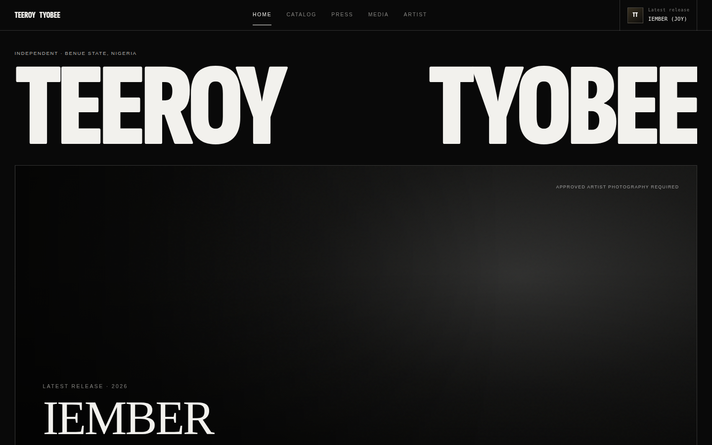
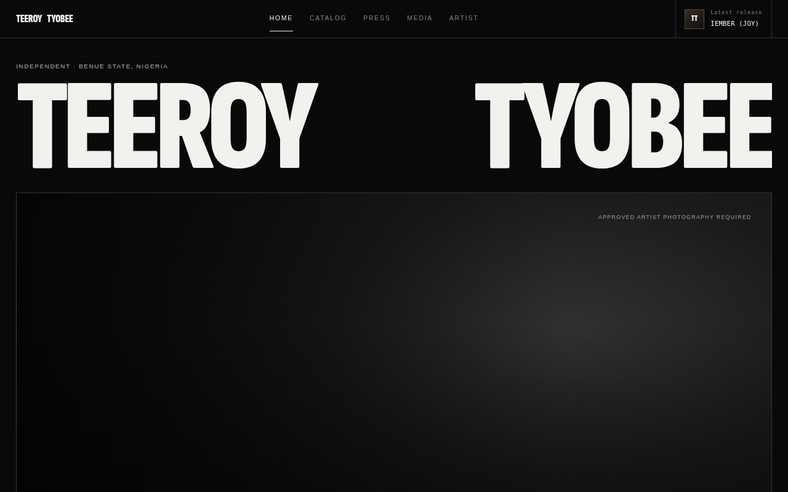
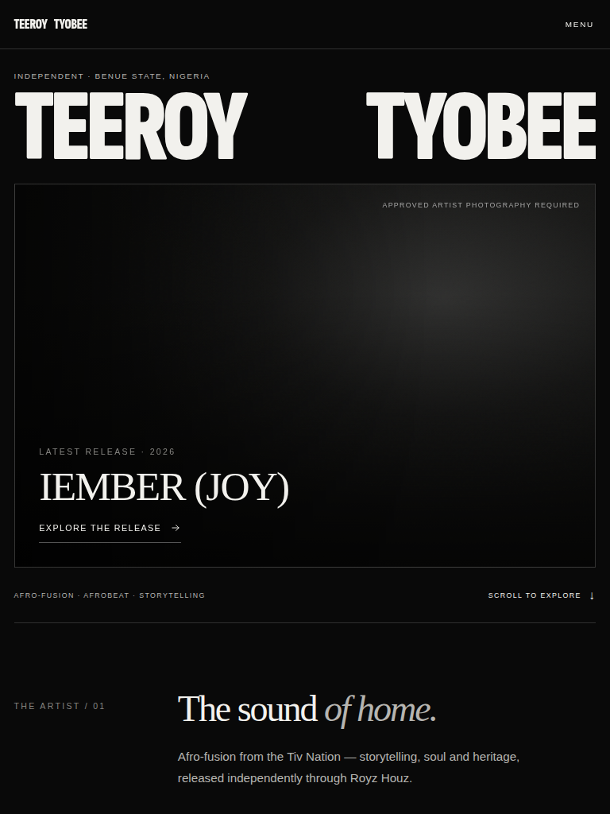
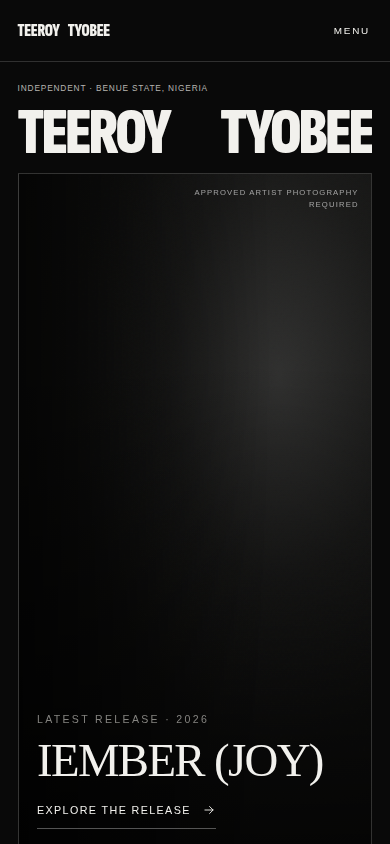
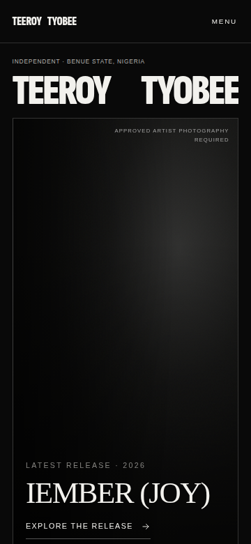

# Visual-parity screenshots

Current-branch Teeroy screenshots are generated by `npm run check:responsive`. They include first-fold captures of six app routes at 1440×900, 1280×800, 768×1024, 390×844, and 360×780; full-page Home captures at the same five sizes; the reduced-motion Home state; desktop work-selection hover; and the mobile menu-open state. The latest metrics are in [`report.json`](teeroy/report.json).

Public Gojett reference captures were used for visual inspection at matching sizes, but are kept outside this repository to avoid shipping third-party photographs as assets. The route findings are recorded in [`../FRAMER-SOURCE-ANALYSIS.md`](../FRAMER-SOURCE-ANALYSIS.md). These are reference-led screenshots, not a claim of pixel-perfect or Framer-source parity.

## Home — first fold and full page

| Viewport | First fold | Full page |
| --- | --- | --- |
| 1440×900 |  | [Full page screenshot](teeroy/home-full-desktop-1440.png) |
| 1280×800 |  | [Full page screenshot](teeroy/home-full-laptop-1280.png) |
| 768×1024 |  | [Full page screenshot](teeroy/home-full-tablet-768.png) |
| 390×844 |  | [Full page screenshot](teeroy/home-full-mobile-390.png) |
| 360×780 |  | [Full page screenshot](teeroy/home-full-mobile-360.png) |

## Route screenshots

`teeroy/catalog-*.png`, `teeroy/release-detail-*.png`, `teeroy/press-*.png`, `teeroy/media-*.png`, and `teeroy/artist-*.png` provide matching first-fold images for each of the five viewport sizes. Interactive states are in `teeroy/home-work-hover-laptop-1280.png` and `teeroy/menu-open-mobile-390.png`. The complete list of image paths and test findings is maintained in `report.json`.
